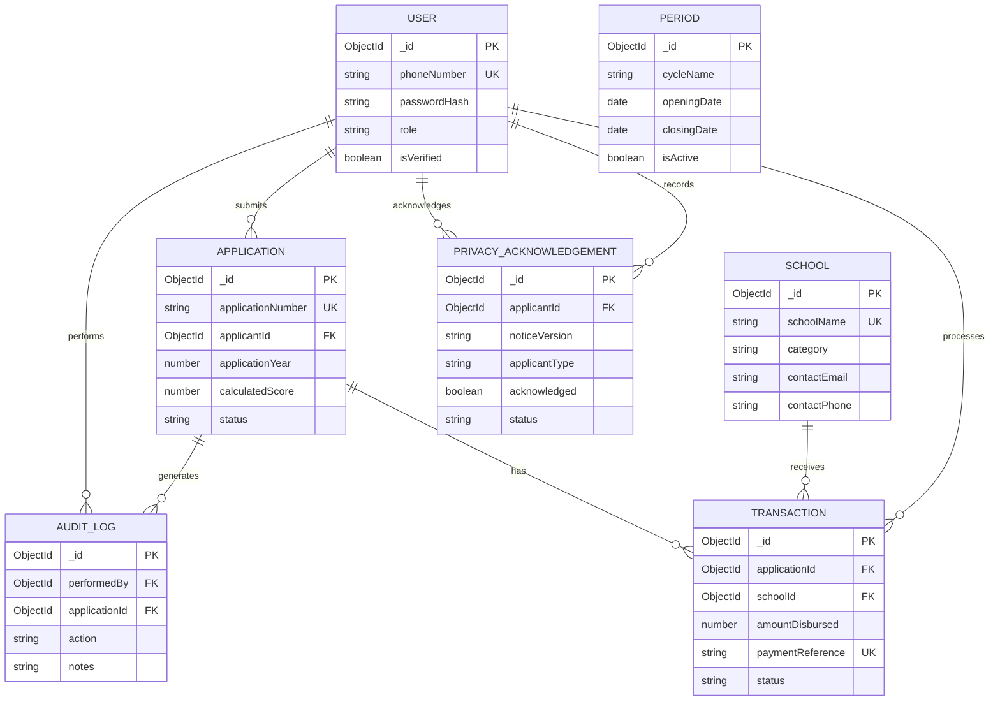

# ElimuPlus – Database Design Documentation

**Project:** ElimuPlus – Ganze NG-CDF Bursary Management System
**Programme Identity:** Ganze's Future
**Database:** MongoDB
**ODM:** Mongoose
**Document Version:** 1.0
**Status:** Active Development

---

## 1. Introduction

This document describes the database design and data structures used in the ElimuPlus bursary management system.

ElimuPlus uses MongoDB as its primary database and Mongoose as its Object Data Modeling (ODM) library.

The database is designed to support:

- User account and profile management.
- Bursary application records.
- Supporting document metadata.
- Document verification and review.
- Bursary application periods.
- School information.
- Financial transactions.
- Administrative audit logs.
- Applicant privacy acknowledgements.

The database design incorporates validation rules, document references, embedded subdocuments and indexes to maintain data consistency and support efficient data retrieval.

## 2. Database Architecture

ElimuPlus currently implements seven primary Mongoose models.

| No. | Collection / Model | Purpose |
|---|---|---|
| 1 | User | Stores user accounts and profiles |
| 2 | Application | Stores bursary applications |
| 3 | Period | Stores bursary application cycles |
| 4 | School | Stores school and payment details |
| 5 | AuditLog | Records administrative activities |
| 6 | Transaction | Records bursary payment transactions |
| 7 | PrivacyAcknowledgement | Records privacy notice acknowledgements |

### 2.1 Database Technology

- Database: MongoDB
- ODM: Mongoose
- Connection library: Mongoose
- Database configuration: `server/Config/db.js`

The MongoDB connection uses the environment variable:

```env
MONGO_URI=your_mongodb_connection_string
```

The application establishes its database connection through the backend database configuration module.

## 3. Database Collection Design

### 3.1 User Collection

**Model:** `User.js`

**Purpose:** Stores user authentication credentials, personal information, geographical details and system roles.

The User collection supports five system roles:

- applicant
- agent
- clerk
- board
- admin

#### Schema Fields

| Field | Data Type | Constraints / Description |
|---|---|---|
| `_id` | ObjectId | MongoDB document identifier |
| `phoneNumber` | String | Required, unique and trimmed |
| `passwordHash` | String | Required; stores hashed password |
| `role` | String | Enum: applicant, agent, clerk, board, admin |
| `profile.fullName` | String | Required |
| `profile.nationalID` | String | Optional, unique and sparse |
| `profile.birthCertificateNumber` | String | Optional, unique and sparse |
| `profile.ward` | String | Required; restricted to configured wards |
| `profile.village` | String | Required |
| `isVerified` | Boolean | Defaults to false |
| `createdAt` | Date | Automatically generated |
| `updatedAt` | Date | Automatically updated |

#### Ward Validation

The permitted ward values are:

- Ganze
- Bamba
- Jaribuni
- Sokoke

#### Identification Validation

The schema contains validation rules preventing an account from providing both a National ID and a birth certificate number.

The two identification fields are independently configured as unique sparse fields.

This allows records without a value for a particular identification field while enforcing uniqueness when a value is provided.

#### Security Considerations

- Passwords are stored as hashes rather than plaintext.
- The authentication middleware excludes `passwordHash` when retrieving authenticated users.
- Public registration assigns the applicant role rather than allowing users to select privileged roles.

### 3.2 Application Collection

**Model:** `Application.js`

**Purpose:** Stores bursary application information, vulnerability assessments, educational information, supporting document metadata, verification decisions and award information.

This is the central collection in the ElimuPlus database.

#### A. Application Identification

| Field | Data Type | Constraints / Description |
|---|---|---|
| `_id` | ObjectId | MongoDB document identifier |
| `applicationNumber` | String | Required and unique |
| `applicantId` | ObjectId | Required reference to User |
| `applicationYear` | Number | Required, immutable, minimum 2020 |
| `createdAt` | Date | Automatically generated |
| `updatedAt` | Date | Automatically updated |

#### B. Vulnerability Metrics

The vulnerability metrics are used in determining an applicant's bursary eligibility score.

| Field | Data Type | Description |
|---|---|---|
| `familyStatus` | String | Family vulnerability category |
| `householdIncomeBracket` | String | Household income category |
| `disabledParents` | Boolean | Indicates parental disability |
| `chronicIllnessInFamily` | Boolean | Indicates chronic illness in the family |
| `siblingsInSchool` | Number | Number of siblings currently in school |

Permitted family status values:

- `total-orphan`
- `partial-orphan-single-parent`
- `both-parents-alive`

Permitted household income brackets:

- `under-10k`
- `10k-30k`
- `above-30k`

`siblingsInSchool` must be a non-negative whole number.

#### C. Confidential Award Scoring

| Field | Data Type | Description |
|---|---|---|
| `calculatedScore` | Number | Automatically calculated vulnerability score |

The score is recalculated using the `scoreCalculator` utility when an application is created or its vulnerability metrics are modified.

The calculated score is confidential and must not be exposed in applicant-facing or unauthorized API responses.

#### D. Education Details

| Field | Data Type | Constraints / Description |
|---|---|---|
| `schoolName` | String | Required, 2–200 characters |
| `studentCategory` | String | Required education category |
| `admissionNumber` | String | Required, maximum 50 characters |
| `outstandingFees` | Number | Required, minimum 0 |

Permitted student categories:

- Primary
- Junior Secondary
- Senior Secondary
- TVET / Polytechnic
- College
- University

#### E. Supporting Documents

The Application model contains an embedded `documents` object.

The system stores references and metadata for five required supporting documents.

| Field | Description |
|---|---|
| `chiefLetter` | Chief's Letter |
| `feeStructure` | School Fee Structure |
| `reportCard` | Academic Report Card |
| `parentIDOrDeathCertificate` | Parent's ID or Death Certificate |
| `studentIDOrBirthCert` | Student's ID or Birth Certificate |

Each document contains the following fields:

| Field | Data Type | Description |
|---|---|---|
| `publicId` | String | Cloudinary public identifier |
| `resourceType` | String | Restricted to raw |
| `format` | String | Restricted to PDF |
| `originalName` | String | Original uploaded filename |
| `bytes` | Number | File size in bytes; minimum 1 |
| `uploadedAt` | Date | Upload timestamp |

The actual PDF files are stored in Cloudinary rather than directly inside MongoDB.

The embedded document schema disables individual MongoDB subdocument IDs.

#### F. Document Review Information

Each supporting document has its own embedded review record.

| Field | Data Type | Description |
|---|---|---|
| `status` | String | Pending, Verified or Rejected |
| `reviewedBy` | ObjectId | Reference to User |
| `notes` | String | Review notes, maximum 2,000 characters |
| `reviewedAt` | Date | Review timestamp |

The default document review status is `Pending`.

This structure enables clerks to review individual supporting documents independently.

#### G. Award Details

The `awardDetails` object stores the application's award and processing information.

| Field | Data Type | Description |
|---|---|---|
| `proposedAmount` | Number | Proposed bursary award |
| `approvedAmount` | Number | Final approved bursary amount |
| `status` | String | Application and award processing status |
| `rejectionReason` | String | Reason for rejection |
| `reviewedBy` | ObjectId | Reference to reviewing User |
| `approvedBy` | ObjectId | Reference to approving User |
| `approvedAt` | Date | Approval timestamp |

Permitted application status values:

- Submitted
- Verified
- Rejected
- Board-Approved
- Disbursed

The default status is `Submitted`.

Proposed and approved amounts default to null and must be non-negative when provided.

#### H. Application Indexing

The Application schema defines:

**Unique application number index**

The `applicationNumber` field is unique.

**Compound unique partial index**

```javascript
ApplicationSchema.index(
  { applicantId: 1, applicationYear: 1 },
  {
    unique: true,
    partialFilterExpression: {
      applicationYear: { $type: 'number' }
    }
  }
);
```

This index prevents an applicant from submitting more than one application for the same application year.

The `applicationYear` field is immutable to prevent an application from being moved to another year after creation.

### 3.3 Period Collection

**Model:** `Period.js`

**Purpose:** Stores bursary application cycle information and application window dates.

#### Schema Fields

| Field | Data Type | Description |
|---|---|---|
| `_id` | ObjectId | MongoDB document identifier |
| `cycleName` | String | Bursary cycle name |
| `openingDate` | Date | Application opening date |
| `closingDate` | Date | Application closing date |
| `isActive` | Boolean | Indicates whether the cycle is active |
| `createdAt` | Date | Automatically generated |
| `updatedAt` | Date | Automatically updated |

The default cycle name is:

`Ganze NG-CDF Bursary Cycle 2026/2027`

The default value of `isActive` is true.

Application-window middleware uses the bursary period information to determine whether applications can be submitted.

### 3.4 School Collection

**Model:** `School.js`

**Purpose:** Stores school information and financial details required for bursary payment administration.

#### Schema Fields

| Field | Data Type | Description |
|---|---|---|
| `_id` | ObjectId | MongoDB document identifier |
| `schoolName` | String | Required and unique |
| `category` | String | Education institution category |
| `bankDetails.bankName` | String | Required bank name |
| `bankDetails.branchName` | String | Required branch name |
| `bankDetails.accountNumber` | String | Required bank account number |
| `bankDetails.paybillNumber` | String | Optional paybill number |
| `contactEmail` | String | Required school email |
| `contactPhone` | String | Required school phone |
| `createdAt` | Date | Automatically generated |
| `updatedAt` | Date | Automatically updated |

Permitted school categories:

- Primary
- Junior Secondary
- Senior Secondary
- TVET / Polytechnic
- College
- University

The School collection provides structured school and payment information.

### 3.5 AuditLog Collection

**Model:** `AuditLog.js`

**Purpose:** Records important administrative activities performed during bursary application processing.

#### Schema Fields

| Field | Data Type | Description |
|---|---|---|
| `_id` | ObjectId | MongoDB document identifier |
| `performedBy` | ObjectId | Required reference to User |
| `applicationId` | ObjectId | Required reference to Application |
| `action` | String | Administrative action |
| `notes` | String | Optional notes, maximum 2,000 characters |
| `ipAddress` | String | Request IP address |
| `createdAt` | Date | Automatically generated |
| `updatedAt` | Date | Automatically updated |

Permitted action values:

- Verified
- Rejected
- Re-reviewed
- Approved
- Disbursed
- Payment-Failed

The audit log provides a record of who performed an action and which application was affected.

### 3.6 Transaction Collection

**Model:** `Transaction.js`

**Purpose:** Stores bursary payment and disbursement transaction records.

#### Schema Fields

| Field | Data Type | Constraints / Description |
|---|---|---|
| `_id` | ObjectId | MongoDB document identifier |
| `applicationId` | ObjectId | Required reference to Application |
| `schoolId` | ObjectId | Required reference to School |
| `amountDisbursed` | Number | Required, greater than zero |
| `paymentReference` | String | Required and unique |
| `status` | String | Pending, Completed or Failed |
| `simulationOnly` | Boolean | Indicates whether the transaction is a simulation |
| `processedBy` | ObjectId | Optional reference to User |
| `completedAt` | Date | Payment completion timestamp |
| `failureReason` | String | Optional failure explanation, maximum 500 characters |
| `createdAt` | Date | Automatically generated |
| `updatedAt` | Date | Automatically updated |

Permitted transaction statuses:

- Pending
- Completed
- Failed

The `simulationOnly` field defaults to false and is required.

#### Transaction Indexing

The schema defines the following indexes:

**Application reference index**

```javascript
{ applicationId: 1 }
```

**School reference index**

```javascript
{ schoolId: 1 }
```

**Unique payment reference**

The `paymentReference` field is unique.

**Compound transaction index**

```javascript
{ applicationId: 1, status: 1 }
```

These indexes support transaction retrieval, payment-reference uniqueness and application payment-status queries.

### 3.7 PrivacyAcknowledgement Collection

**Model:** `PrivacyAcknowledgement.js`

**Purpose:** Stores records showing that applicants have acknowledged the ElimuPlus privacy notice.

The collection also supports guardian-related information for minor applicants.

#### A. Main Schema Fields

| Field | Data Type | Description |
|---|---|---|
| `_id` | ObjectId | MongoDB document identifier |
| `applicantId` | ObjectId | Required reference to User |
| `noticeVersion` | String | Required privacy notice version |
| `noticeTitle` | String | Privacy notice title |
| `noticeHash` | String | Optional SHA-256 notice hash |
| `applicantType` | String | adult or minor |
| `acknowledged` | Boolean | Required and must be true |
| `acknowledgedAt` | Date | Date of acknowledgement |
| `guardian` | Object | Embedded guardian information |
| `status` | String | Privacy acknowledgement status |
| `recordedBy` | ObjectId | Required reference to User |
| `withdrawnAt` | Date | Withdrawal timestamp |
| `withdrawalReason` | String | Reason for withdrawal |
| `ipAddress` | String | Optional IP address |
| `userAgent` | String | Optional browser information |
| `createdAt` | Date | Automatically generated |
| `updatedAt` | Date | Automatically updated |

Permitted applicant types:

- adult
- minor

Permitted acknowledgement statuses:

- Recorded
- Guardian-Verification-Pending
- Verified
- Rejected
- Withdrawn

#### B. Guardian Information

Guardian information is stored in an embedded subdocument.

| Field | Data Type | Description |
|---|---|---|
| `fullName` | String | Guardian's full name |
| `relationship` | String | Parent or Legal Guardian |
| `phoneNumber` | String | Guardian phone number |
| `consentGiven` | Boolean | Records guardian's declaration |
| `verificationStatus` | String | Guardian verification status |
| `verifiedAt` | Date | Verification timestamp |
| `verifiedBy` | ObjectId | Reference to User |
| `verificationNotes` | String | Verification notes |

Permitted guardian relationships:

- Parent
- Legal Guardian

Permitted verification statuses:

- Not-Required
- Pending
- Verified
- Rejected

The guardian schema disables individual MongoDB subdocument IDs.

A recorded guardian declaration is not automatically considered verified consent.

#### C. Privacy Indexing

The schema defines:

**Applicant lookup index**

```javascript
{ applicantId: 1 }
```

**Applicant acknowledgement history index**

```javascript
{
  applicantId: 1,
  createdAt: -1
}
```

These indexes support retrieval of applicant privacy acknowledgement records and chronological acknowledgement history.

## 4. Database Relationships

ElimuPlus uses MongoDB ObjectId references to connect related records.

The primary references defined in the schemas are:

| Source Model | Field | Referenced Model |
|---|---|---|
| Application | applicantId | User |
| Application | documentReviews.*.reviewedBy | User |
| Application | awardDetails.reviewedBy | User |
| Application | awardDetails.approvedBy | User |
| AuditLog | performedBy | User |
| AuditLog | applicationId | Application |
| Transaction | applicationId | Application |
| Transaction | schoolId | School |
| Transaction | processedBy | User |
| PrivacyAcknowledgement | applicantId | User |
| PrivacyAcknowledgement | recordedBy | User |
| PrivacyAcknowledgement | guardian.verifiedBy | User |

### 4.1 Relationship Explanation

**User and Application**

One applicant can have multiple application records across different application years.

However, the unique compound index restricts each applicant to one application per application year.

**Application and AuditLog**

An application can have multiple audit log entries documenting its processing history.

Each audit log entry references one application and one user who performed the action.

**Application and Transaction**

An application can have associated transaction records.

Each transaction references one application.

**School and Transaction**

A school can be associated with multiple bursary transactions.

Each transaction references one school.

**User and PrivacyAcknowledgement**

A user can have privacy acknowledgement records associated with their account.

Each acknowledgement references the applicant and the user who recorded it.

### 4.2 Important Schema Relationships

The current Application schema stores `educationDetails.schoolName` as a String rather than an ObjectId reference to the School model.

Similarly, the Period model currently has no direct reference field to Application.

These are important distinctions in the current implementation and should be considered when planning future database improvements.

## 5. Entity Relationship Diagram (ERD)

The following diagram represents the principal relationships defined by the current Mongoose schemas.



**Note:** The diagram shows the principal collection relationships. Embedded document metadata, document reviews, guardian information and other nested fields remain within their respective parent documents. The Period collection currently operates independently without a direct Application reference.

## 6. Embedded Documents and Subdocuments

MongoDB allows related information to be stored within a single parent document.

ElimuPlus uses embedded structures in two important models.

### Application

The Application document embeds:

- Vulnerability metrics.
- Education details.
- Supporting document metadata.
- Individual document review records.
- Award details.

### PrivacyAcknowledgement

The PrivacyAcknowledgement document embeds:

- Guardian details.
- Guardian consent declaration.
- Guardian verification information.

This design keeps closely related information together and allows it to be retrieved with the parent record.

## 7. Database Indexing Strategy

Database indexes improve data retrieval and enforce uniqueness where required.

The current schema defines the following indexes and uniqueness constraints:

| Collection | Indexed Field(s) | Purpose |
|---|---|---|
| User | phoneNumber | Unique user phone number |
| User | profile.nationalID | Unique sparse identification |
| User | profile.birthCertificateNumber | Unique sparse identification |
| Application | applicationNumber | Unique application reference |
| Application | applicantId + applicationYear | Prevent duplicate yearly applications |
| Transaction | applicationId | Transaction lookup |
| Transaction | schoolId | School transaction lookup |
| Transaction | paymentReference | Unique payment reference |
| Transaction | applicationId + status | Transaction status queries |
| PrivacyAcknowledgement | applicantId | Applicant lookup |
| PrivacyAcknowledgement | applicantId + createdAt | Acknowledgement history |

Additional indexes may be introduced as the application grows and query performance requirements become clearer.

## 8. Data Validation and Integrity

ElimuPlus uses Mongoose schema validation to protect data consistency.

Important validation rules include:

1. Required user information must be provided.
2. User phone numbers must be unique.
3. National ID and birth certificate number cannot both be provided on the same profile.
4. User roles are restricted to approved values.
5. Application years must be valid numbers and cannot be modified after creation.
6. Application numbers must be unique.
7. Applicants cannot submit multiple applications for the same year.
8. Vulnerability metrics must use approved categories.
9. Sibling counts must be non-negative whole numbers.
10. Outstanding school fees cannot be negative.
11. All five supporting documents are required.
12. Uploaded document metadata must identify PDF files stored as raw Cloudinary resources.
13. Review statuses must use approved values.
14. Transaction amounts must be greater than zero.
15. Payment references must be unique.
16. Privacy acknowledgement must be explicitly true.

## 9. Data Security and Confidentiality

The database contains personal and potentially sensitive applicant information.

Important security considerations include:

- Password hashes must never be returned to unauthorized clients.
- Authentication must be enforced through backend middleware.
- Role-based authorization must protect administrative operations.
- Vulnerability scores and proposed award amounts must not be unnecessarily exposed.
- Cloudinary document identifiers must not be disclosed through applicant-facing responses.
- Reviewer identifiers must be protected from unauthorized disclosure.
- Database credentials must be stored in environment variables.
- Applicant privacy acknowledgement records must be handled securely.
- Financial records must be accessible only to authorized users.

## 10. Data Lifecycle

The main application data lifecycle is:

1. A user creates an account.
2. An applicant acknowledges the privacy notice.
3. The applicant submits a bursary application.
4. The system stores application information and document metadata.
5. The clerk reviews individual supporting documents.
6. Verification and rejection decisions are recorded.
7. The board makes an award decision.
8. Payment processing creates transaction records where applicable.
9. Audit logs preserve important administrative activities.

## 11. Future Database Improvements

Potential future improvements include:

- Establishing a direct relationship between Application and Period.
- Linking Application education records to School using a validated school reference.
- Introducing additional transaction reconciliation fields where required.
- Strengthening audit-log immutability.
- Reviewing historical application migration and index consistency.
- Implementing database backup and recovery procedures.
- Introducing additional reporting indexes based on real query patterns.

Any changes should be implemented through reviewed schema migrations and tested before production deployment.

## 12. Conclusion

The ElimuPlus database design provides the foundation for managing bursary applicants, applications, supporting documents, verification activities, award decisions, schools, financial transactions and privacy acknowledgements.

MongoDB and Mongoose provide a flexible data model while supporting structured validation, document references, embedded records and indexing.

The database is designed to support transparency, data integrity, accountability and secure bursary administration.

---

**Project:** ElimuPlus
**Programme:** Ganze NG-CDF Bursary Programme
**Database:** MongoDB
**ODM:** Mongoose
**Document:** Database Design
**Version:** 1.0
**Status:** Active Development