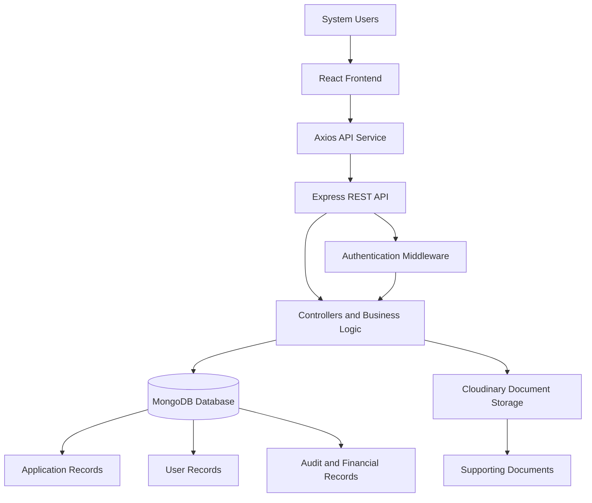
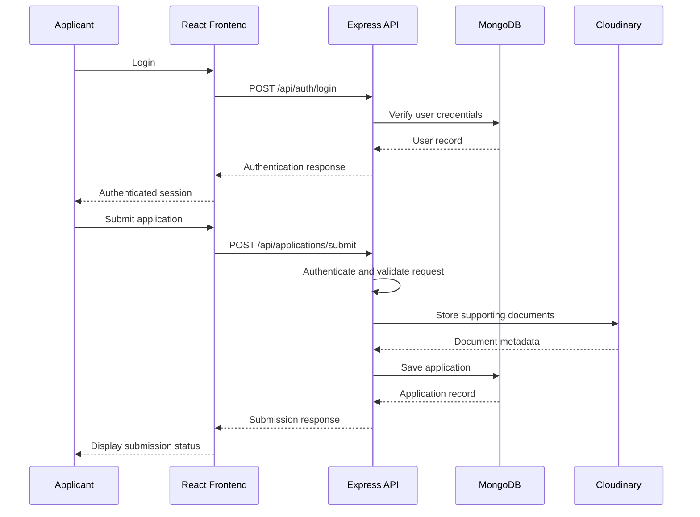

# ElimuPlus – System Architecture

**Project:** ElimuPlus – Ganze NG-CDF Bursary Management System
**Programme Identity:** Ganze's Future
**Location:** Ganze Sub-County, Kilifi County, Kenya
**Document Type:** Technical Architecture Documentation
**Status:** Active Development

---

## 1. Introduction

This document describes the technical architecture of ElimuPlus, a web-based bursary management system designed to digitize the administration of the Ganze NG-CDF Bursary Programme.

The architecture explains the interaction between the frontend, backend, database, authentication services and external document storage.

The system follows a client-server architecture with a React frontend communicating with a REST API developed using Node.js and Express.

MongoDB provides persistent data storage, while Cloudinary is integrated for document storage.

## 2. Architecture Overview

ElimuPlus is organized into three primary architectural layers:

1. Presentation Layer
2. Application Layer
3. Data and Storage Layer

### 2.1 High-Level Architecture Diagram



The frontend handles user interaction, while the backend processes business operations, enforces access control and communicates with persistent storage services.

## 3. Presentation Layer – Frontend

### 3.1 Technology

The frontend is developed using:

- React 19
- JavaScript (ES Modules)
- Vite
- Tailwind CSS 4
- React Router DOM
- Axios

### 3.2 Frontend Responsibilities

The presentation layer is responsible for:

- Displaying the application interface.
- Managing user navigation.
- Providing registration and login interfaces.
- Displaying applicant dashboards.
- Displaying clerk application-review interfaces.
- Supporting document submission and viewing.
- Communicating with backend API endpoints.
- Protecting frontend routes according to user roles.

### 3.3 Frontend Structure

The frontend source code is organized as follows:

```text
client/
└── src/
    ├── Components/
    │   ├── Applicant/
    │   ├── Auth/
    │   ├── Clerk/
    │   ├── ApplicationCountdown.jsx
    │   ├── Footer.jsx
    │   ├── Herosection.jsx
    │   ├── Navbar.jsx
    │   └── StatCard.jsx
    │
    ├── Context/
    │   ├── authcontext.jsx
    │   ├── authContextValue.js
    │   └── useAuth.js
    │
    ├── Pages/
    │   ├── Home.jsx
    │   ├── About.jsx
    │   ├── Login.jsx
    │   ├── Register.jsx
    │   ├── Consent.jsx
    │   ├── ApplicantDashboard.jsx
    │   ├── ClerkDashboard.jsx
    │   └── MyApplicationDetails.jsx
    │
    ├── Service/
    │   └── api.js
    │
    ├── assets/
    ├── App.jsx
    ├── App.css
    ├── index.css
    └── main.jsx
```

### 3.4 Routing and Navigation

React Router DOM manages application navigation.

Public routes include:

| Route | Purpose |
|---|---|
| `/` | Homepage |
| `/about` | About the project |
| `/register` | Applicant registration |
| `/login` | User authentication |
| `/privacy-notice` | Privacy acknowledgement |

Protected applicant routes:

| Route | Purpose |
|---|---|
| `/applicant-dashboard` | Applicant dashboard |
| `/my-application` | Application details |

Protected clerk route:

| Route | Purpose |
|---|---|
| `/clerk-dashboard` | Clerk review dashboard |

The `ProtectedRoute` component checks authentication and permitted user roles before granting access to protected frontend pages.

### 3.5 Authentication Context

The authentication context manages frontend authentication state.

Its responsibilities include:

- Managing the authenticated user.
- Handling registration and login.
- Retrieving the authenticated user's profile.
- Maintaining authentication state.
- Supporting logout.
- Providing authentication information through the `useAuth` hook.

The frontend uses an Axios request interceptor to attach available JWT tokens to protected API requests.

## 4. Application Layer – Backend

### 4.1 Technology

The backend is developed using:

- Node.js
- Express 5
- JavaScript (CommonJS)
- Mongoose
- JSON Web Tokens
- bcryptjs
- Multer
- Cloudinary SDK
- Express Rate Limit

### 4.2 Backend Responsibilities

The backend is responsible for:

- Processing HTTP requests.
- Authenticating users.
- Enforcing role-based authorization.
- Validating bursary applications.
- Managing application submissions.
- Processing document verification.
- Managing bursary award decisions.
- Recording audit activities.
- Communicating with MongoDB.
- Managing uploaded documents.
- Enforcing application-period restrictions.

### 4.3 Backend Structure

```text
server/
│
├── Config/
│   ├── db.js
│   └── cloudinary.js
│
├── controllers/
│   ├── adminController.js
│   ├── applicationController.js
│   ├── authController.js
│   └── privacyController.js
│
├── middleware/
│   ├── authMiddleware.js
│   ├── rateLimitMiddleware.js
│   ├── uploadMiddleware.js
│   └── windowMiddleware.js
│
├── models/
│   ├── Application.js
│   ├── AuditLog.js
│   ├── Period.js
│   ├── PrivacyAcknowledgement.js
│   ├── School.js
│   ├── Transaction.js
│   └── User.js
│
├── routes/
│   ├── adminRoutes.js
│   ├── applicationRoutes.js
│   ├── authRoutes.js
│   └── privacyRoute.js
│
├── scripts/
│   └── createClerk.js
│
├── test/
│
├── utils/
│   ├── awardCalculator.js
│   ├── cache.js
│   └── scoreCalculator.js
│
├── app.js
└── server.js
```

### 4.4 API Gateway

The Express application in `app.js` acts as the central API gateway.

The API routes are mounted under the following prefixes:

| API Prefix | Responsibility |
|---|---|
| `/api/auth` | Registration, login and authentication |
| `/api/applications` | Application submission, review and documents |
| `/api/admin` | Administrative operations and bursary periods |
| `/api/privacy` | Privacy acknowledgement management |

The backend also implements:

- CORS middleware.
- JSON request parsing.
- General API rate limiting.
- Global error handling.
- A health-check endpoint.

The health-check endpoint is:

```http
GET /
```

It returns the API project name and operational status.

### 4.5 Authentication and Authorization

ElimuPlus uses JSON Web Tokens (JWT) for authentication.

The authentication middleware is implemented in:

```text
server/middleware/authMiddleware.js
```

The `protect` middleware:

1. Extracts the Bearer token from the Authorization header.
2. Verifies the JWT using the configured secret.
3. Retrieves the corresponding user from MongoDB.
4. Excludes the password hash from the retrieved user.
5. Attaches the authenticated user to the request.

The `authorizeRoles` middleware checks whether the authenticated user has permission to access a particular resource.

The system supports the following roles:

- Applicant
- Agent
- Clerk
- Board
- Admin

Authentication and authorization are enforced on the backend independently of frontend route protection.

## 5. Data Layer – Database

### 5.1 Database Technology

ElimuPlus uses MongoDB as its primary database, with Mongoose providing object data modelling.

Database connection configuration is maintained in:

```text
server/Config/db.js
```

The connection uses the `MONGO_URI` environment variable.

### 5.2 Database Models

The current backend contains the following Mongoose models:

| Model | Responsibility |
|---|---|
| User | User accounts, profiles and roles |
| Application | Bursary application information |
| Period | Bursary application cycles |
| School | School information |
| AuditLog | Administrative activity records |
| Transaction | Financial transaction records |
| PrivacyAcknowledgement | Applicant privacy acknowledgements |

### 5.3 Data Management

MongoDB stores structured application and administrative information.

This includes user accounts, application records, document metadata, verification decisions, bursary awards, audit activities and financial transaction records.

Sensitive information is controlled through backend validation, authentication and authorization.

## 6. Document Storage Layer

### 6.1 Cloudinary Integration

ElimuPlus integrates Cloudinary for supporting-document storage.

Configuration is maintained in:

```text
server/Config/cloudinary.js
```

The integration uses environment variables for:

- Cloudinary cloud name.
- API key.
- API secret.

### 6.2 Document Upload Process

The document upload process uses Multer middleware and Cloudinary storage integration.

The intended process is:

1. Applicant selects the required supporting document.
2. Frontend submits the document to the backend.
3. Multer processes the uploaded file.
4. Backend validates the file.
5. Valid documents are uploaded to Cloudinary.
6. Document metadata is associated with the application in MongoDB.
7. Authorized clerks access documents through protected backend endpoints.

The system supports PDF documents for bursary application submissions.

### 6.3 Required Supporting Documents

The five document categories are:

1. Chief's Letter.
2. School Fee Structure.
3. Academic Report Card.
4. Parent's ID or Death Certificate.
5. Student's ID or Birth Certificate.

Document access is controlled through backend authorization.

## 7. Frontend and Backend Communication

### 7.1 Communication Protocol

The frontend communicates with the backend through HTTP requests using Axios.

The current development API base URL is:

```javascript
const BackendBaseUrl = 'http://localhost:5000';
const APIBaseUrl = `${BackendBaseUrl}/api`;
```

### 7.2 JWT Request Authorization

The Axios request interceptor retrieves the available token from browser local storage.

Protected requests include:

```http
Authorization: Bearer YOUR_JWT_TOKEN
```

The backend validates the token before allowing access to protected resources.

### 7.3 Example Communication Flow



## 8. Application Security Architecture

Security is implemented across both frontend and backend layers.

Key security controls include:

- JWT authentication.
- Password hashing using bcryptjs.
- Role-based authorization.
- Protected API routes.
- Server-side validation.
- Rate limiting.
- Controlled document access.
- Sensitive response-data filtering.
- Audit logging.

Frontend route protection improves navigation security and user experience, but backend authorization remains the primary security enforcement mechanism.

## 9. Testing Architecture

### 9.1 Backend Testing

Backend testing uses:

- Jest
- Supertest
- MongoDB Memory Server

Tests cover areas including:

- Application functionality.
- Authentication.
- Authorization.
- Application security.
- Document handling.
- Application workflows.
- Rate limiting.

### 9.2 Frontend Testing

Frontend testing uses:

- Vitest
- React Testing Library
- Jest DOM
- User Event

The frontend also includes Playwright for end-to-end testing.

## 10. Environment Configuration

The backend uses environment variables for sensitive configuration.

Important configuration variables include:

| Variable | Purpose |
|---|---|
| `PORT` | Backend server port |
| `MONGO_URI` | MongoDB connection string |
| `JWT_SECRET` | JWT signing and verification secret |
| `CLOUDINARY_CLOUD_NAME` | Cloudinary account identifier |
| `CLOUDINARY_API_KEY` | Cloudinary API key |
| `CLOUDINARY_API_SECRET` | Cloudinary API secret |

Environment files must never be committed to public version control.

## 11. Deployment Architecture

The current architecture supports local development.

The following deployment components are intended for production planning:

- Frontend hosting for the React application.
- Backend hosting for the Express API.
- Managed MongoDB database.
- Cloudinary document storage.
- Production environment configuration.
- HTTPS and secure deployment settings.

Production hosting and deployment configuration must be documented separately once implemented and verified.

## 12. Current Implementation Status

| Component | Status |
|---|---|
| React frontend | Implemented |
| Express backend | Implemented |
| MongoDB integration | Implemented |
| JWT authentication | Implemented |
| Role-based access control | Implemented |
| Applicant dashboard | Implemented |
| Clerk dashboard | Implemented |
| Document upload integration | Implemented |
| Clerk document verification | Implemented |
| Audit logging models | Implemented |
| Board workflow | Under development and verification |
| Financial processing | Under development and verification |
| Production deployment | Pending |

Implementation status should be updated as development progresses.

## 13. Conclusion

The ElimuPlus architecture provides a foundation for a secure, maintainable and scalable digital bursary management platform.

The separation of frontend presentation, backend business logic, database persistence and document storage supports independent development and maintenance of system components.

The architecture is designed to strengthen transparency, operational efficiency and accountability in the administration of the Ganze NG-CDF Bursary Programme.

---

**Document:** System Architecture
**Project:** ElimuPlus
**Version:** 1.0
**Status:** Active Development